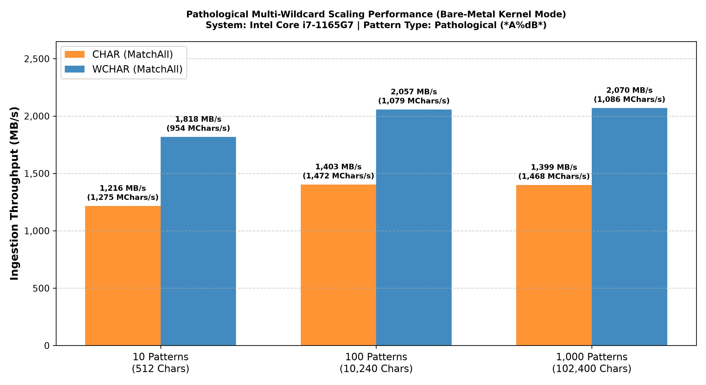
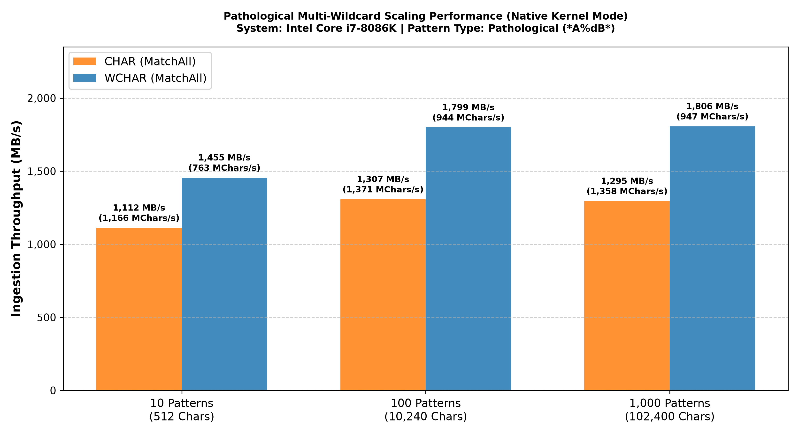
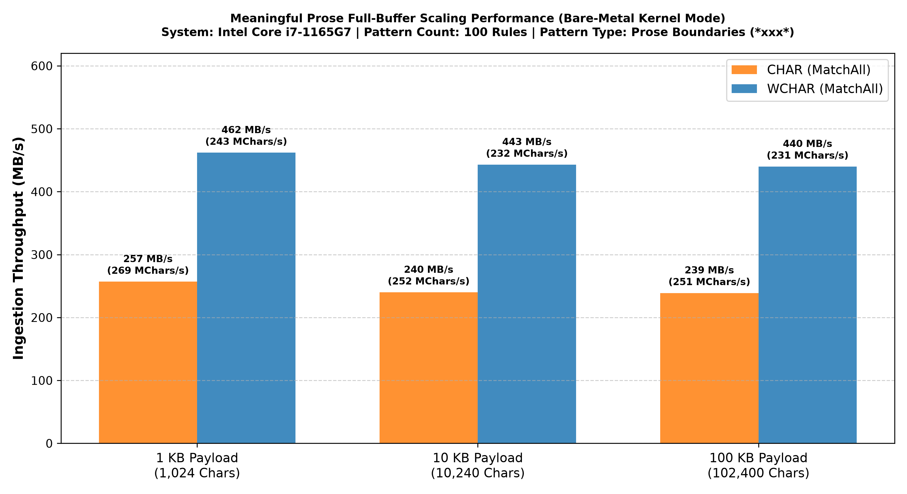
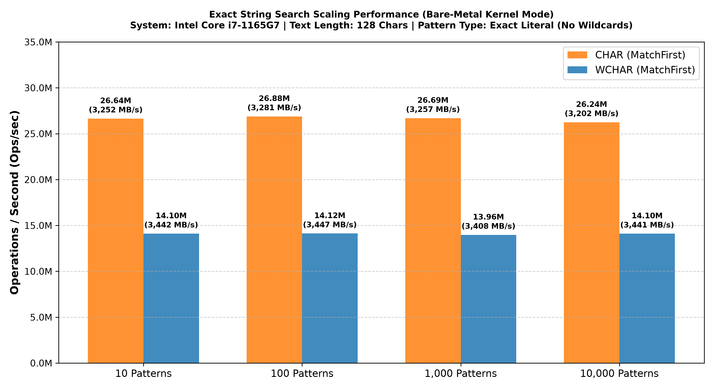
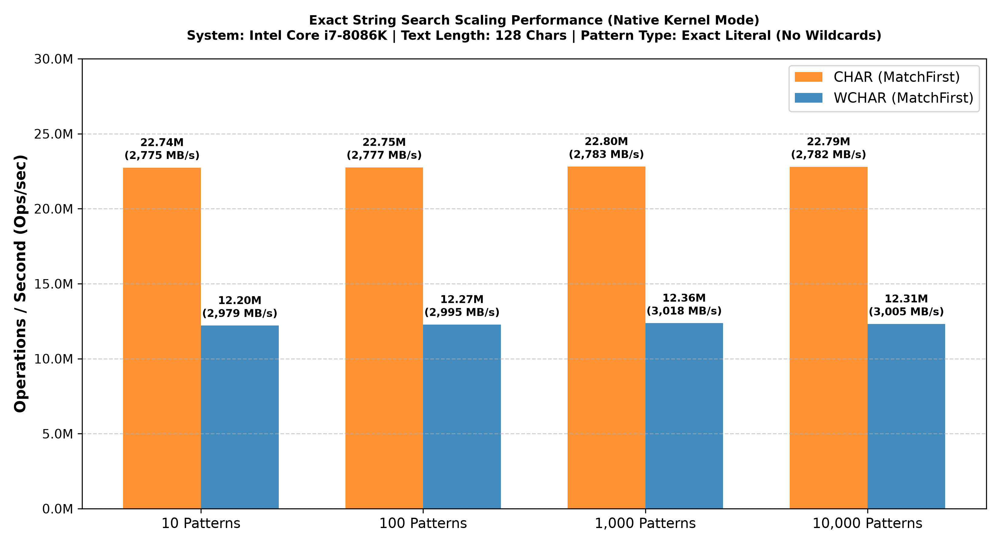
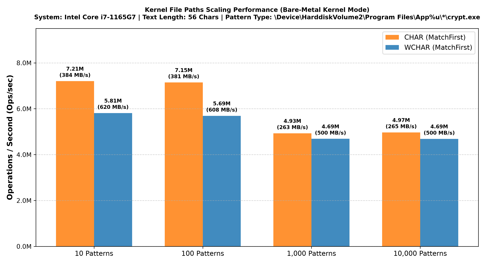
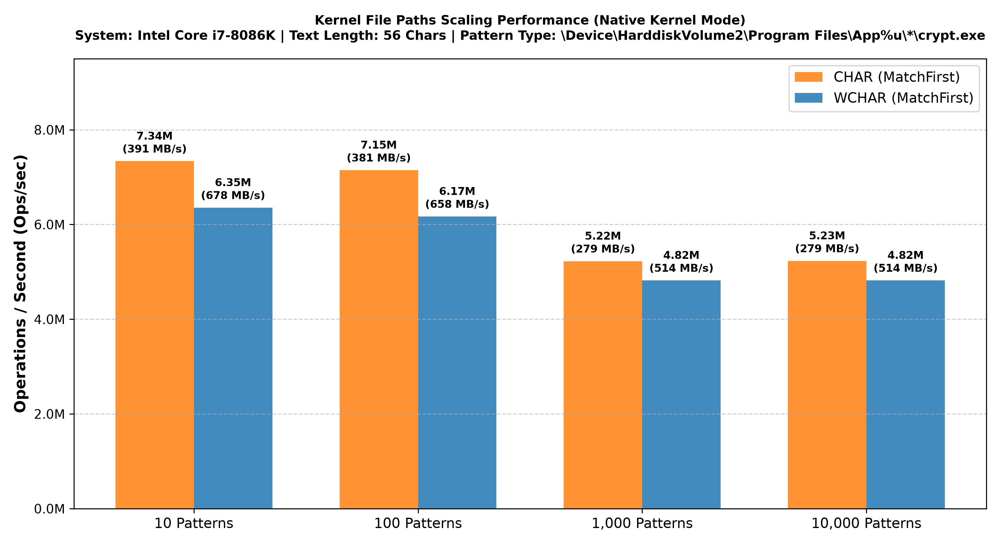

# High-Performance Bit-Parallel Thompson NFA for Kernel Wildcard Matching

-blue)


* **Single-Pass $O(N)$ Multi-Pattern Matching:** Evaluates all $K$ registered rules simultaneously in one linear pass over an $N$-character string, eliminating $O(K)$ rule loops and backtracking blowups.
* **Pure 64-Bit GPR SWAR Acceleration:** Vectorizes parallel ASCII case-folding, wildcard skipping, and literal-run verification in general-purpose registers—zero SSE/AVX context-save penalties.
* **Zero-Allocation Fast-Path & RCU-Ready Concurrency:** Executes lock-free on the kernel stack up to 4,032 states and supports lock-free `const` readers for RCU-style hot-reloading (`EX_RUNDOWN_REF` / [`KmSharedPtr`](https://github.com/adanil-code/KmSharedPtr)).
* **Kernel-Safe by Design:** Strictly non-recursive, native path-segment scoping (`SCOPE_PATH_SEGMENT`), and `DISPATCH_LEVEL` execution for `CHAR` and case-sensitive `WCHAR`.
* **User-Mode WDK Test Harness:** Includes a correctness and benchmark suite compilable in user space for rapid debugging without VM deployment.

## Table of Contents
1. [Overview](#overview)
2. [Architecture & Algorithms](#architecture--algorithms)
3. [Quick Start API Overview](#quick-start-api-overview)
   * [Pattern Syntax & Wildcard Scoping](#pattern-syntax--wildcard-scoping)
   * [Resolution Precedence & Ordering Semantics](#resolution-precedence--ordering-semantics)
   * [Template Parameters](#template-parameters)
   * [Public API Methods](#public-api-methods)
   * [Example Implementation](#example-implementation)
4. [Benchmarks & Scaling Performance](#benchmarks--scaling-performance)
   * [Test Methodology & Benchmark Architecture](#test-methodology--benchmark-architecture)
   * [Performance Results](#performance-results)
   * [Scaling Characteristics Across Pattern Densities](#scaling-characteristics-across-pattern-densities)
5. [Project Layout](#project-layout)
6. [Building Instructions](#building-instructions)
7. [Conclusion](#conclusion)
8. [License](#license)

---

## Overview

`KmWildcardNfa` is a high-performance, bit-parallel Thompson Non-Deterministic Finite Automaton (NFA) engine built explicitly for Windows kernel-mode drivers, file system minifilters, and real-time EDR/security telemetry. Unlike native single-pattern kernel routines such as `FsRtlIsNameInExpression`—which force sequential $O(K)$ loops over $K$ registered rules—and unlike backtracking wildcard matchers that degrade to exponential or $O(N^2)$ time on multi-wildcard expressions, `KmWildcardNfa` compiles hundreds or thousands of wildcard patterns into a unified prefix-deduplicated state graph and evaluates all $K$ patterns **simultaneously in a single linear $O(N)$ pass** over an input string of length $N$ characters.

To support precision file system filtering, the engine natively implements path segment scoping (`SCOPE_PATH_SEGMENT`), which halts wildcard expansion (`*` and `?`) upon encountering native directory separator boundaries (`\`).

### Key Architectural Highlights
* **Concurrent Multi-Pattern Evaluation & RCU-Style Hot-Reloading:** Once `Compile()` succeeds, `MatchFirst()` and `MatchAll()` are `const` and safe for simultaneous execution across arbitrary CPU cores without spinlocks or reader-writer locks. Callers should not synchronize across `MatchFirst()` / `MatchAll()` and `AddPattern()` / `Compile()` calls; instead, hot-reloading should follow an RCU-style (Read-Copy-Update) pattern by building and compiling a new `KmWildcardNfa` instance out-of-band, atomically replacing the active instance pointer (e.g., via `InterlockedExchangePointer`), and retiring the old instance once in-flight readers drain (e.g., via `EX_RUNDOWN_REF` or an atomic shared pointer such as [`KmSharedPtr`](https://github.com/adanil-code/KmSharedPtr)).
* **Match Resolution Precedence (`MatchFirst` vs. `MatchAll`):** FIFO registration ordering applies strictly at **end-of-input** among patterns sharing the same accepting Trie state (and within ascending state-index traversal across distinct accepting states). In `MatchFirst()`, terminal `SCOPE_DEFAULT` `*` patterns residing in Word 0 (`m_ullWord0PermanentAcceptMask`) trigger **immediate mid-string early termination** upon activation, taking precedence over patterns that resolve at end-of-input. For EDR and filesystem minifilter policies where contexts encode distinct security actions (e.g., `BLOCK`, `ALLOW`, `AUDIT`), use `MatchAll()` to collect all matching rules and apply explicit policy precedence.
* **Two-Tier Hierarchical Bitset State Tracking & Allocation Model:**
  * **Stack Fast-Path ($\le 63$ State Words / $\le 4,032$ States):** Executes entirely on the kernel stack using a single 64-bit active-word mask register (`ulCurrentWordsMask`). This path performs **zero pool allocations** and is **unconditionally lock-free**.
  * **3-Level Supermask Hierarchy ($> 63$ State Words / up to $262,144$ States):** Tracks up to 4,096 state words via a top-level 64-bit `ulSuperMask` register.
    * *Normal Execution Path (Uncontended):* Acquires a pre-allocated, pre-zeroed Non-Paged Pool member scratch buffer (`m_pulScratchStateBuffer`) via a lock-free atomic latch (`InterlockedCompareExchangeAcquire`), performing sparse `ulSuperMask` initialization and cleanup with **zero runtime pool allocations**.
    * *Contention Fallback & Allocation Behavior:* If multiple threads concurrently evaluate the same large ($> 63$ state words) NFA instance, threads that observe the member scratch buffer already in use fall back to a per-call `ExAllocatePool2(POOL_FLAG_NON_PAGED, ...)` and `ExFreePoolWithTag(...)` allocation. While scratch-buffer acquisition is lock-free, the contention fallback invokes the kernel pool allocator.
* **Pattern & State Capacity Limits:**
  * **Compiled State Ceiling (`262,144` States):** The 64-bit 3-level bitset hierarchy (`ulSuperMask` $\rightarrow$ 64-bit `WordsMask` $\rightarrow$ 64-bit `StateWord`) enforces a hard limit of **262,144 deduplicated NFA states** (`MAX_INSTRUCTIONS = 4,096 state words × 64 states/word`), with up to **4,032 states** (`63` state words) served by the stack-only fast-path.
  * **Maximum Pattern Count:** Constrained directly by this **262,144-state** budget rather than a separate fixed pattern limit:
    * *Worst Case (Completely Disjoint Patterns):* $\lfloor 262{,}144 / L_{\text{avg}} \rfloor$ patterns, where $L_{\text{avg}}$ is the average number of states per rule (e.g., ~8,000 rules at 32 states per rule when patterns share zero prefixes).
    * *Typical Kernel Use Case (Shared Prefixes):* Real-world kernel rulesets—such as NT device paths, registry keys, and minifilter rules—heavily share directory prefixes (`\Device\HarddiskVolume...`, `\Registry\Machine\...`, `\Windows\System32\...`). Since `BuildPrefixTrie()` deduplicates shared prefixes and `MATCH_LINK_NODE` chains multiple contexts onto shared accepting states, typical kernel configurations comfortably scale to **tens of thousands of patterns**.
* **Pure 64-Bit GPR SWAR Acceleration (No SSE/AVX):** All parallel character upcasing, wildcard skipping, and literal-run verification execute exclusively in 64-bit general-purpose registers (GPRs), avoiding the heavy `KeSaveExtendedProcessorState` / `KeRestoreExtendedProcessorState` overhead required to touch SSE/AVX registers in Windows kernel mode.
* **Compile-Time Trie Prefix Merging & Chain-Contiguous Sibling BFS:** Deduplicates shared literal and wildcard prefixes across patterns into a unified DAG while packing single-child chains into the same 64-bit state word to maximize bit-parallel locality.
* **Non-Recursive Execution:** Windows kernel-mode threads operate on a tightly constrained stack (approximately three pages on supported configurations). `KmWildcardNfa` is strictly iterative and non-recursive during matching, preventing stack exhaustion regardless of input length $N$ or wildcard complexity.
* **IRQL Compatibility:**
  * **`AddPattern()` & `Compile()`:** Allocate staging and transient Trie build structures from pool and require `IRQL <= APC_LEVEL`.
  * **`Clear()`:** Releases Non-Paged Pool buffers and supports execution up to `IRQL <= DISPATCH_LEVEL`.
  * **`MatchFirst()` & `MatchAll()` (`CHAR`):** Both case-sensitive and case-insensitive 8-bit `CHAR` matching operate strictly on non-paged state tables and branchless ASCII arithmetic, supporting execution up to `IRQL <= DISPATCH_LEVEL` (provided the caller's target text and output buffers are resident/non-paged).
  * **`MatchFirst()` & `MatchAll()` (`WCHAR` — Case-Sensitive):** Supports execution up to `IRQL <= DISPATCH_LEVEL` across the full 16-bit Unicode range (`0x0000..0xFFFF`), as all internal NFA state tables reside in Non-Paged Pool and no NLS uppercase lookups are performed when `bCaseInsensitive == FALSE`. Caller-supplied buffers (`pszText`, `pOutContext` / `pOutContexts`, `pulMatchCount`, and the `KmWildcardNfa` instance) must be resident/non-paged at `DISPATCH_LEVEL`; evaluating paged `WCHAR` buffers requires `IRQL < DISPATCH_LEVEL` (`PASSIVE_LEVEL` / `APC_LEVEL`).
  * **`MatchFirst()` & `MatchAll()` (`WCHAR` — Case-Insensitive):** Must execute at `IRQL == PASSIVE_LEVEL` when evaluating non-ASCII Unicode code points ($\ge \text{0x80}$), as `RtlUpcaseUnicodeChar` accesses paged system NLS uppercase tables that cannot be faulted in at elevated IRQL (pure-ASCII $\le \text{0x7F}$ characters are pre-folded into `ullAsciiMatchMask[128]` and `ToUpperSwar`, and the engine guards against page faults by degrading to exact comparison if invoked at `DISPATCH_LEVEL` in release builds).

---

## Architecture & Algorithms

### High-Level Design
`KmWildcardNfa` separates pattern preprocessing from runtime evaluation through a three-stage lifecycle:
1. **Registration Phase (`AddPattern`):** Validates inputs and appends patterns into a geometrically grown Non-Paged Pool staging array (`PATTERN_ENTRY`, starting at 16 entries and doubling up to $2^{31}$ entries subject to pool availability). When `bCaseInsensitive` is enabled, pattern characters are pre-normalized to uppercase in-place during insertion using 64-bit SWAR (`SwarUpcaseBuffer`). Mutating methods (`AddPattern`, `Compile`, `Clear`) are not thread-safe with respect to each other or concurrent readers. Clients should not synchronize across `MatchFirst()` / `MatchAll()` and `AddPattern()` / `Compile()` calls (e.g., via reader-writer locks); instead, hot-reloading should use an RCU-style pattern: construct and `Compile()` a new matcher instance out-of-band, atomically swap the active instance pointer (e.g., via `InterlockedExchangePointer`), and destroy the old instance after active readers drain (e.g., via `EX_RUNDOWN_REF` or a kernel atomic shared pointer such as [`KmSharedPtr`](https://github.com/adanil-code/KmSharedPtr)).
2. **Compilation Phase (`Compile`):**
   * **Prefix Trie Deduplication (`BuildPrefixTrie`):** Inserts all staged patterns into a transient Paged Pool prefix Trie (`TRIE_NODE`), collapsing consecutive `*` operators into single self-looping `Op::Star` states, resolving `|` escape sequences, appending terminal `Op::Accept` states for patterns not ending in `*`, and linking caller contexts (`MATCH_LINK_NODE`) in FIFO registration order. Enforces the strict post-deduplication limit of 262,144 (`MAX_INSTRUCTIONS`) compiled states.
   * **Chain-Contiguous Sibling BFS (`AssignStateIndicesBfs`):** Assigns linear state indices (`0..ulTotalStates - 1`) in breadth-first order while immediately packing single-child chains into contiguous bit positions inside the same 64-bit state word.
   * **Instruction, Filter & Bitvector Generation (`AllocateRuntimeTables` & `PopulateInstructionsAndFilters`):** Computes epsilon-closures (`ComputeNodeTransitionClosure`), stores each state's primary target word inline inside a 16-byte `NFA_INSTRUCTION`, spills multi-word closures to `EXTRA_TARGET_WORD`, builds per-word 128-entry ASCII compatibility masks (`WORD_SWAR_FILTER`) with pre-folded lowercase slots (`'a'..'z'`), and consolidates `InitialStates`, `AcceptStates`, and `InitialWordsMask` into a single contiguous Non-Paged Pool allocation.
   * **SWAR Fast-Path Precomputation:** Configures root `*` steady-state exit character broadcasts (`ConfigureStarSteadyStateSkip`), hoists shared anchored root literal prefixes ($\ge$ `CHARS_PER_QUAD`) into `m_pszLiteralRuns` while advancing initial states to the post-prefix closure (`ConfigureRootLiteralPrefix`), and indexes unbranched mid-Trie literal chains (`BuildLiteralRunTables`). Finally, `m_bCompiled` is published via `WriteBooleanRelease` so all runtime tables are globally visible on ARM64 and x64 before concurrent readers observe the compiled state.
3. **Execution Phase (`ExecuteVm<bCaseInsensitive>`):** Dispatches at compile time on `bCaseInsensitive`, verifies any shared anchored root literal prefix 8 bytes at a time, and steps through the bit-parallel Thompson NFA using register-direct SWAR skipping, unbranched literal-run fast-forwarding, permanent-accept early exits, and 64-way bit-parallel state filtering.

### 1. Compile-Time Trie Prefix Merging & Chain-Contiguous Sibling BFS
When monitoring thousands of file system paths (e.g., `\Device\HarddiskVolume2\Program Files\...`), patterns share long common prefixes. `BuildPrefixTrie` collapses identical transitions into a single shared path in the Trie, eliminating redundant state tracking across common prefixes.

During state numbering, `AssignStateIndicesBfs` combines breadth-first sibling grouping with greedy single-child chain packing:
* Sibling branches at a fork receive adjacent bit indices so a single 64-bit word filter evaluates all branches simultaneously.
* Unbranched chains of literal transitions are packed contiguously into the same 64-bit state word, maximizing cache locality and minimizing cross-word overflow transitions (`EXTRA_TARGET_WORD`).

### 2. Hierarchical Bitset State Tracking & Scratch Buffer Lifecycle
Depending on the compiled state count after Trie deduplication, `ExecuteVm` automatically selects one of two execution paths:
* **Path A ($\le 63$ State Words / $\le 4,032$ States — Stack Fast-Path):**
  * **Normal Execution Path:** Maintains ping-pong state buffers (`StatesBufferA` and `StatesBufferB`) directly on the kernel stack and tracks non-zero state words inside a single 64-bit register (`ulCurrentWordsMask`). Active words and states are traversed in $O(1)$ per set bit using `_BitScanForward64` and Brian Kernighan bit-clearing (`x &= (x - 1)`).
  * **Allocation & Concurrency Behavior:** Performs **zero pool allocations** and touches **no shared mutable state**, making Path A unconditionally lock-free and wait-free across all concurrent threads.
* **Path B ($> 63$ State Words / up to $262,144$ States — 3-Level `ulSuperMask` Hierarchy):**
  * **Normal Execution Path (Uncontended):** Uses a 3-level bitset hierarchy headed by a single 64-bit register (`ulSuperMask`), where bit $m$ indicates that the 2nd-level mask word `pCurrentWordsMask[m]` is non-zero, and each bit in `pCurrentWordsMask[m]` tracks one 64-bit state word (up to $64 \times 64 = 4,096$ state words $= 262,144$ states). At `Compile()` time, a pre-zeroed Non-Paged Pool scratch buffer (`m_pulScratchStateBuffer`) is pre-allocated on the class instance. An entering thread claims this buffer via `InterlockedCompareExchangeAcquire(&m_lScratchBufferInUse, 1, 0) == 0`, initializes only the active words indicated by `m_ulInitialSuperMask`, and sparsely zeroes only the remaining dirty words via `ulSuperMask` before releasing the latch with `WriteRelease(&m_lScratchBufferInUse, 0)`. When uncontended, Path B performs **zero runtime pool allocations**.
  * **Contention Fallback:** If a second thread concurrently enters `MatchFirst()` or `MatchAll()` on the same Path B NFA instance while `m_lScratchBufferInUse == 1`, the atomic compare-exchange fails immediately without spinning or blocking.
  * **Allocation Behavior Under Contention:** The contending thread allocates a temporary per-call scratch buffer from Non-Paged Pool via `ExAllocatePool2(POOL_FLAG_NON_PAGED, cbScratchWords * sizeof(ULONG64), NFA_POOL_TAG)` and releases it via `ExFreePoolWithTag(pScratchBase, NFA_POOL_TAG)` upon returning (or returns `FALSE` if pool resources are exhausted). Consequently, while the scratch-buffer handoff itself is lock-free, the contention fallback path invokes the Windows kernel pool allocator.

### 3. Pure 64-Bit SWAR Acceleration Suite (No SSE/AVX)
`KmWildcardNfa` embeds five 64-bit SWAR (SIMD Within A Register) optimizations that operate on 8 `CHAR`s or 4 `WCHAR`s per register load:
* **Parallel ASCII Case-Folding (`SwarUpcaseQuad` / `ToUpperSwar`):** Uses `IsAsciiSwar` (`(ullQuad & SWAR_ASCII_HIGH_MASK) == 0`) to verify that all lanes in a 64-bit load are standard ASCII, then case-folds all 8 bytes or 4 `WCHAR`s simultaneously via branchless range arithmetic (`ullGeA & ~ullGtZ`, `ullQuad ^ (ullIsLower >> 2)`). Blocks containing non-ASCII code points ($\ge \text{0x80}$) branch to an out-of-line `__declspec(noinline) SwarUpcaseQuadFallback` helper to keep the hot loop compact in L1 instruction cache.
* **Steady-State & Dynamic Word-0 `*` Skipping (`TrySkipWord0SteadyStateSwar`):** Whenever Word 0 is the sole active state word and is self-sustained by `SCOPE_DEFAULT` `Op::Star` states (`m_ullWord0DefaultStarMask`), the VM scans 8 bytes (`CHARS_PER_QUAD` characters) per iteration using Mycroft zero-lane detection (`SwarHasChar64`) against up to 2 broadcast exit characters, jumping `cchOffset` directly to the exact matching lane via `_BitScanForward64(&ulMatchBit, ullZero)` shifted right by `LANE_BITS_SHIFT` (`>> 3` for `CHAR`, `>> 4` for `WCHAR`). When more than 2 exit states or wildcard exits are active in Word 0, it falls back to an unrolled per-lane `FilterActiveStatesSwar` cascade.
* **Permanent Accepting State Early-Exit (`CheckWord0PermanentAccept`):** Precomputes `m_ullWord0PermanentAcceptMask` for terminal `SCOPE_DEFAULT` `Op::Star` accepting states in Word 0 (patterns ending in `*`). During `MatchFirst()`, activating any bit in this mask immediately resolves the caller's `TContext` (via `_BitScanForward64` and the head of its FIFO `MATCH_LINK_NODE` chain) and returns `TRUE` mid-string without scanning the remainder of the input buffer.
* **Unbranched Literal-Run & Anchored Root Prefix Verification (`VerifyLiteralRunSwar` / `TryAdvanceLiteralRunSwar`):** Shared root literal prefixes ($\ge$ `CHARS_PER_QUAD`) and unbranched mid-Trie `Op::Literal` chains are verified 8 bytes at a time in-register, using an overlapping 64-bit tail load at `(ulRunLen - CHARS_PER_QUAD)` for unaligned lengths.
* **64-Way Bit-Parallel State Filtering (`FilterActiveStatesSwar`):** Each 64-state word has a precomputed `WORD_SWAR_FILTER` containing `ullAsciiMatchMask[128]`. When `bCaseInsensitive` is enabled, `PopulateInstructionsAndFilters` mirrors uppercase `'A'..'Z'` state bits into lowercase `'a'..'z'` slots at compile time—allowing the VM to filter all 64 states in a word with a single bitwise `AND` and zero per-character ASCII upcasing instructions.

### 4. Cache-Line-Engineered Data Layout
To prevent cache-line pollution on hot lookups, `KmWildcardNfa` splits state data by access frequency and aligns class members across 64-byte cache lines:

```text
KmWildcardNfa Instance Layout (152 Bytes across 3 x 64-Byte Cache Lines)
+---------------------------------------------------------------------------------------------------+
| CACHE LINE 0 (Bytes 0..63): Hot Read-Only VM Execution Scalars & Core Table Pointers              |
+-------------------+-------------------+-------------------+-------------------+-------------------+
| Bytes 0..3        | Bytes 4..7        | Bytes 8..11       | Bytes 12..15      | Bytes 16..23      |
| bCaseInsens (1B)  | m_ulStateWords64  | m_ulPrefixLength  | [4B Align Pad]    | m_pInstructions*  |
| bCompiled   (1B)  |       (4B)        |       (4B)        |                   |       (8B)        |
| [2B Pad]          |                   |                   |                   |                   |
+-------------------+-------------------+-------------------+-------------------+-------------------+
| Bytes 24..31      | Bytes 32..39      | Bytes 40..47      | Bytes 48..55      | Bytes 56..63      |
| m_pStateMetadata* | m_pWordFilters*   | m_pExtraTargets*  | m_pMatchLinks*    | m_pulInitialSts*  |
|       (8B)        |       (8B)        |       (8B)        |       (8B)        |       (8B)        |
+---------------------------------------------------------------------------------------------------+
| CACHE LINE 1 (Bytes 64..127): Literal-Run Table, Precomputed SWAR Masks & Path-B Scratch Pointer  |
+-------------------+-------------------+-------------------+-------------------+-------------------+
| Bytes 64..71      | Bytes 72..79      | Bytes 80..87      | Bytes 88..95      | Bytes 96..103     |
| m_pszLiteralRuns* | m_ulInitSuperMask | m_ullSteadyWord0  | m_ullStarExit1    | m_ullStarExit2    |
|       (8B)        |       (8B)        |       (8B)        |       (8B)        |       (8B)        |
+-------------------+-------------------+-------------------+-------------------+-------------------+
| Bytes 104..111    | Bytes 112..119    | Bytes 120..127                                            |
| m_ullWord0DefStar | m_ullWord0PermAcc | m_pulScratchStateBuffer* (Pre-zeroed Path-B scratch)      |
|       (8B)        |       (8B)        |                          (8B)                             |
+---------------------------------------------------------------------------------------------------+
| CACHE LINE 2 (Bytes 128..151): Cold Staging Metadata & Tail-Isolated Path-B Atomic Latch          |
+-------------------+-------------------+-------------------+-------------------+-------------------+
| Bytes 128..135    | Bytes 136..139    | Bytes 140..143    | Bytes 144..147    | Bytes 148..151    |
| m_pPatterns*      | m_ulPatternCount  | m_ulPatternCap    | m_lScratchInUse   | [4B Struct Pad]   |
|       (8B)        |       (4B)        |       (4B)        | (volatile LONG)   |                   |
+-------------------+-------------------+-------------------+-------------------+-------------------+

Hot Compiled State Descriptor: NFA_INSTRUCTION (16 Bytes -> 4 Instructions per 64-Byte Cache Line)
+-----------------------------------+-----------------------+-------------------+-------------------+
| Bytes 0..7 (8B)                   | Bytes 8..11 (4B)      | Bytes 12..13 (2B) | Bytes 14..15 (2B) |
| ullTargetBits (Primary 64b mask)  | ulExtraOffset         | usTargetWord      | usExtraCount      |
|                                   | [Bit 31: LitRunFlag]  | (or MAXUSHORT)    | (Overflow count)  |
+-----------------------------------+-----------------------+-------------------+-------------------+
```

* **Hot 16-Byte `NFA_INSTRUCTION`:** Packs `ullTargetBits` (8B), `ulExtraOffset` (4B, with bit 31 serving as `NFA_INST_LITERAL_RUN_FLAG`), `usTargetWord` (2B), and `usExtraCount` (2B) so **4 instructions fit per 64-byte cache line**.
* **Cold `NFA_STATE_METADATA`:** Isolates literal-run offsets/lengths, non-ASCII literal characters, and `MATCH_LINK_NODE` head indices so states without literal runs never touch cold metadata during state transitions.
* **Inlined Context Links (`MATCH_LINK_NODE`):** Inlines `TContext` directly into the accepting state's singly-linked match list, eliminating secondary pointer chases during `MatchFirst()` and `MatchAll()`.

---

## Quick Start API Overview

`KmWildcardNfa` is header-only (`KmWildcardNfa.h`) and requires only standard WDK headers. Instances are explicitly non-copyable (`delete`d copy constructor and copy assignment operator) to prevent shallow copies of Non-Paged Pool tables.

### Pattern Syntax & Wildcard Scoping

#### 1. Supported Wildcard Operators
* **`*` (Zero or More Characters):** Matches any sequence of zero or more characters within the configured `WILD_CARD_SCOPE`. Adjacent asterisks (e.g., `**`) are automatically collapsed into a single self-looping `Op::Star` state during `BuildPrefixTrie()`.
* **`?` (Single Character):** Matches any single character within the configured `WILD_CARD_SCOPE`.

#### 2. Literal Escaping (`|`)
The engine reserves the pipe character (`|`) as an escape prefix so reserved wildcard symbols can be matched literally:
* **`|*`**: Matches a literal asterisk (`*`).
* **`|?`**: Matches a literal question mark (`?`).
* **`||`**: Matches a literal pipe (`|`).
* **Unrecognized or Dangling Escapes:** If `|` is followed by any other character, or appears at the very end of a pattern, it is treated safely as a verbatim literal character without buffer overreads.

#### 3. Path Boundary Scoping (`WILD_CARD_SCOPE`)
* **`SCOPE_DEFAULT` (`0`):** Unrestricted wildcard expansion across all characters, including native path separators (`\`). Ideal for rules spanning multiple directory depths (e.g., `\Device\*\Confidential\*.dat`).
* **`SCOPE_PATH_SEGMENT` (`1`):** Confines wildcard operators (`*` and `?`) to a single path segment by blocking expansion across `\` boundaries (e.g., `\Device\HarddiskVolume1\Temp\*.tmp` will not match nested subdirectories).

### Resolution Precedence & Ordering Semantics

When multiple registered patterns match an input string, `MatchFirst()` and `MatchAll()` follow distinct resolution rules that are critical for EDR and filesystem filtering policies where `TContext` encodes security actions (such as `BLOCK`, `ALLOW`, or `AUDIT`):

1. **Permanent-Accept Mid-String Early Termination (`MatchFirst()` Only):**
   * Any pattern ending in an unrestricted `*` (`Op::Star` with `SCOPE_DEFAULT`) whose compiled state resides in Word 0 (`ulStateIdx < 64`) is recorded in `m_ullWord0PermanentAcceptMask`.
   * During `MatchFirst()`, as soon as any bit in `m_ullWord0PermanentAcceptMask` becomes active—even on character 0 for a leading-`*` rule or immediately after a prefix match—`MatchFirst()` **terminates immediately** via `CheckWord0PermanentAccept()` without scanning the rest of the string.
   * **Precedence Consequence:** A broad `SCOPE_DEFAULT` wildcard rule ending in `*` (for example, `\Device\HarddiskVolume1\*` with action `AUDIT` or `ALLOW`) will preempt a more specific rule (for example, `\Device\HarddiskVolume1\Temp\*.tmp` with action `BLOCK`) in `MatchFirst()` regardless of which pattern was registered first, because the specific rule cannot accept until end-of-input. If multiple permanent-accepting states in Word 0 are active on the same step, the lowest state index (`_BitScanForward64`) wins, resolving the head of its FIFO `MATCH_LINK_NODE` chain.
2. **End-of-Input Resolution & FIFO Ordering (`MatchFirst()` and `MatchAll()`):**
   * When no Word-0 permanent-accepting state triggers mid-string early exit (always true in `MatchAll()`, and true in `MatchFirst()` when only non-permanent states are active), evaluation proceeds to the end of the input string (`cchOffset == cchLen`).
   * At end-of-input, `HarvestWordMatches()` scans surviving accepting state bits in ascending `ulStateIdx` order (determined by Chain-Contiguous Sibling BFS), and for each accepting state walks its `MATCH_LINK_NODE` linked list in **strict FIFO registration order**.
   * Consequently, **FIFO registration order is guaranteed among patterns that share the same accepting Trie state** (such as identical patterns registered with different contexts, or patterns collapsing to the same terminal node). Across *distinct* accepting Trie nodes, end-of-input order follows ascending BFS `ulStateIdx` rather than global `AddPattern()` call order.
3. **Security Policy Guidance:**
   * Use **`MatchFirst()`** when all rules share a uniform action (e.g., pure indicator/IOC detection where any hit triggers telemetry) or when all rules are exact / `SCOPE_PATH_SEGMENT` / non-`*`-terminated patterns.
   * Use **`MatchAll()`** whenever rules carry conflicting security actions (e.g., `BLOCK` vs. `ALLOW` overrides), so all matching contexts are harvested and resolved by your driver's policy priority logic.

### Template Parameters
`template <typename TContext, typename TChar = WCHAR>`
* **`TContext`**: Caller-supplied context payload type associated with each pattern (e.g., rule ID, flags struct, or pointer). Enforced at compile time via `static_assert(__is_trivially_copyable(TContext))`.
* **`TChar`**: Character type (`WCHAR` for 16-bit Unicode or `CHAR` for 8-bit ANSI/ASCII). Enforced at compile time via `static_assert(sizeof(TChar) == 1 || sizeof(TChar) == 2)`. Convenience type aliases `KmWildcardNfaW<TContext>` and `KmWildcardNfaA<TContext>` are provided.

### Public API Methods

```cpp
explicit KmWildcardNfa(_In_ BOOLEAN bCaseInsensitive = TRUE) noexcept;
```
* Constructs an empty NFA instance. When `bCaseInsensitive` is `TRUE` (default), pattern registration and string evaluation normalize ASCII (`a-z` $\rightarrow$ `A-Z`) and Unicode code points.

```cpp
_IRQL_requires_max_(APC_LEVEL)
NTSTATUS AddPattern(_In_reads_or_z_(cchLen) const TChar* __restrict    pszPattern,
                    _In_                    size_t                     cchLen,
                    _In_                    WILD_CARD_SCOPE            eScope,
                    _In_                    const TContext& __restrict rContext) noexcept;
```
* Stages a wildcard pattern and its associated `TContext` payload into a geometrically grown Non-Paged Pool array (up to $2^{31}$ staged entries, bounded by available pool and the 262,144 post-deduplication compiled state limit in `Compile()`). Invalidates any previously compiled runtime tables if called after `Compile()`. Returns `STATUS_INVALID_PARAMETER` on invalid arguments or `STATUS_INSUFFICIENT_RESOURCES` on capacity overflow or allocation failure.
* **`pszPattern` / `cchLen`**: Pointer to the pattern buffer and its character count (excluding any null terminator).
* **`eScope`**: `WILD_CARD_SCOPE::SCOPE_DEFAULT` or `WILD_CARD_SCOPE::SCOPE_PATH_SEGMENT`.
* **`rContext`**: Caller payload copied into the pattern entry.

```cpp
_IRQL_requires_max_(APC_LEVEL)
NTSTATUS Compile() noexcept;
```
* Compiles all staged patterns into a prefix-deduplicated Trie NFA and populates all SWAR acceleration tables. Returns `STATUS_SUCCESS` on completion or `STATUS_INSUFFICIENT_RESOURCES` if pool allocation fails or the deduplicated state count exceeds `MAX_INSTRUCTIONS` (**262,144 states**). Maximum supported pattern count depends on prefix overlap (from $\lfloor 262{,}144 / L_{\text{avg}} \rfloor$ for completely disjoint patterns up to tens of thousands of shared-prefix kernel rules).

```cpp
_IRQL_requires_max_(DISPATCH_LEVEL)
BOOLEAN MatchFirst(_In_reads_or_z_(cchLen) const TChar* __restrict pszText,
                   _In_                    size_t                  cchLen,
                   _Out_opt_               TContext* __restrict    pOutContext) const noexcept;
```
* Evaluates `pszText` against all compiled patterns simultaneously and returns `TRUE` upon resolving a match (populating `*pOutContext` if non-`NULL`), or `FALSE` if no pattern matches. Word-0 permanent-accepting `SCOPE_DEFAULT` `*` states trigger immediate mid-string early return; otherwise, end-of-input resolution scans ascending state indices and walks each accepting state's contexts in **FIFO registration order**. Supports `IRQL <= DISPATCH_LEVEL` for `CHAR`, case-sensitive `WCHAR`, and pure-ASCII case-insensitive `WCHAR` when the `KmWildcardNfa` instance and caller buffers are resident/non-paged; non-ASCII case-insensitive `WCHAR` matching requires `PASSIVE_LEVEL` (and paged buffers require `IRQL < DISPATCH_LEVEL`).

```cpp
_IRQL_requires_max_(DISPATCH_LEVEL)
BOOLEAN MatchAll(_In_reads_or_z_(cchLen)        const TChar* __restrict pszText,
                 _In_                           size_t                  cchLen,
                 _Out_writes_opt_(ulMaxMatches) TContext* __restrict    pOutContexts,
                 _In_                           ULONG                   ulMaxMatches,
                 _Out_opt_                      ULONG* __restrict       pulMatchCount) const noexcept;
```
* Evaluates `pszText` to end-of-input against all compiled patterns (without mid-string early exit), writing up to `ulMaxMatches` matching contexts into `pOutContexts` (in ascending accepting state index order, and **FIFO registration order** per accepting state) and storing the total match count in `*pulMatchCount` (if non-`NULL`). Returns `TRUE` if at least one pattern matched. Supports `IRQL <= DISPATCH_LEVEL` for `CHAR`, case-sensitive `WCHAR`, and pure-ASCII case-insensitive `WCHAR` when the `KmWildcardNfa` instance and caller buffers are resident/non-paged; non-ASCII case-insensitive `WCHAR` matching requires `PASSIVE_LEVEL` (and paged buffers require `IRQL < DISPATCH_LEVEL`).

```cpp
_IRQL_requires_max_(DISPATCH_LEVEL)
VOID Clear() noexcept;
```
* Releases all staged pattern strings and compiled NFA tables, resetting the instance to a clean empty state without requiring destruction.

### Example Implementation

```cpp
#include <ntddk.h>
#include "KmWildcardNfa.h"

// 1. Define a trivially copyable payload to associate with patterns
enum class RuleAction : ULONG
{
    Allow = 0,
    Block = 1,
    Audit = 2
};

struct RuleContext
{
    ULONG      RuleId;
    RuleAction Action;
};

// Main execution routine (must be called at IRQL == PASSIVE_LEVEL for WCHAR matching)
_IRQL_requires_(PASSIVE_LEVEL)
NTSTATUS RunWildcardNfaExample()
{
    PAGED_CODE();

    // 2. Initialize the WCHAR NFA engine in case-insensitive mode (TRUE)
    KmWildcardNfaW<RuleContext> nfa(TRUE);

    // 3. Register Patterns
    // Block all '.tmp' files inside a specific directory without crossing '\' boundaries.
    static constexpr WCHAR kRule1[] = L"\\Device\\HarddiskVolume1\\Temp\\*.tmp";
    RuleContext rule1 = { 1001, RuleAction::Block };
    NTSTATUS status = nfa.AddPattern(kRule1,
                                     RTL_NUMBER_OF(kRule1) - 1,
                                     KmWildcardNfaW<RuleContext>::SCOPE_PATH_SEGMENT,
                                     rule1);
    if (!NT_SUCCESS(status))
    {
        return status;
    }

    // Match sensitive '.dat' files across arbitrary subdirectory depths.
    static constexpr WCHAR kRule2[] = L"\\Device\\*\\Confidential\\*.dat";
    RuleContext rule2 = { 1002, RuleAction::Block };
    status = nfa.AddPattern(kRule2,
                            RTL_NUMBER_OF(kRule2) - 1,
                            KmWildcardNfaW<RuleContext>::SCOPE_DEFAULT,
                            rule2);
    if (!NT_SUCCESS(status))
    {
        return status;
    }

    // Broad volume-level audit rule ending in SCOPE_DEFAULT '*' (permanent-accept state).
    static constexpr WCHAR kRule3[] = L"\\Device\\HarddiskVolume1\\*";
    RuleContext rule3 = { 1003, RuleAction::Audit };
    status = nfa.AddPattern(kRule3,
                            RTL_NUMBER_OF(kRule3) - 1,
                            KmWildcardNfaW<RuleContext>::SCOPE_DEFAULT,
                            rule3);
    if (!NT_SUCCESS(status))
    {
        return status;
    }

    // 4. Compile all staged patterns into the bit-parallel NFA
    status = nfa.Compile();
    if (!NT_SUCCESS(status))
    {
        return status;
    }

    // 5. Evaluate Input Text (Executed at PASSIVE_LEVEL here due to case-insensitive WCHAR;
    // case-sensitive WCHAR, pure-ASCII WCHAR, and CHAR also support IRQL <= DISPATCH_LEVEL
    // when target and output buffers are non-paged).
    // Note: For hot-reloading rules in production, build and Compile() a new
    // KmWildcardNfaW instance out-of-band, atomically swap the active pointer
    // via InterlockedExchangePointer, and retire the old instance after readers
    // drain (e.g., via EX_RUNDOWN_REF or KmSharedPtr: https://github.com/adanil-code/KmSharedPtr).
    static constexpr WCHAR kTargetPath[] = L"\\Device\\HarddiskVolume1\\Temp\\cache.tmp";
    constexpr size_t targetLen = RTL_NUMBER_OF(kTargetPath) - 1;

    // MatchFirst triggers immediate mid-string early exit once kRule3's permanent-accept '*'
    // state activates after "\Device\HarddiskVolume1\", returning RuleId 1003 (Audit).
    RuleContext matchedContext = { 0 };
    if (nfa.MatchFirst(kTargetPath, targetLen, &matchedContext))
    {
        DbgPrint("MatchFirst resolved Rule ID: %lu (Action: %lu)\n",
                 matchedContext.RuleId,
                 static_cast<ULONG>(matchedContext.Action));
    }

    // MatchAll evaluates to end-of-input without permanent-accept early termination,
    // collecting both kRule1 (1001, Block) and kRule3 (1003, Audit) for policy resolution.
    RuleContext allMatches[8] = { 0 };
    ULONG       matchCount    = 0;

    if (nfa.MatchAll(kTargetPath,
                     targetLen,
                     allMatches,
                     static_cast<ULONG>(RTL_NUMBER_OF(allMatches)),
                     &matchCount))
    {
        const ULONG collectedCount = (matchCount < static_cast<ULONG>(RTL_NUMBER_OF(allMatches)))
            ? matchCount
            : static_cast<ULONG>(RTL_NUMBER_OF(allMatches));

        for (ULONG i = 0; i < collectedCount; i++)
        {
            DbgPrint("MatchAll resolved Rule ID: %lu (Action: %lu)\n",
                     allMatches[i].RuleId,
                     static_cast<ULONG>(allMatches[i].Action));
        }
    }

    // 6. Cleanup
    nfa.Clear();
    return STATUS_SUCCESS;
}
```

---

## Benchmarks & Scaling Performance

All functional correctness tests and performance benchmark tiers (48 tiers) were executed on **x64 Windows 11** using the unified C++20 test suite (`TestKmWildcardNfa.h`) included in the repository.

To streamline development and debugging, **the project supports compiling and executing the exact kernel NFA header in both native kernel mode and user mode**. Using lightweight WDK API stubs (`ntddk.h`), developers can step through state transitions, verify SWAR bitmasks, and run the full correctness suite in user space before deploying the native `.sys` test driver for bare-metal kernel telemetry.

### Test Methodology & Benchmark Architecture

The test harness (`TestKmWildcardNfa.h`) isolates execution and measures physical ingestion bandwidth using the following principles:

* **Kernel Logging & Persistent Telemetry Capture:** When running as a kernel driver, the test suite streams real-time progress via `DbgPrintEx(DPFLTR_IHVDRIVER_ID, ...)` and flushes the complete benchmark report to `\SystemRoot\Temp\KmWildcardNfaPerf.txt`.
* **Correctness-First Execution Gating:** Prior to running any performance tier, the harness executes functional unit tests (52 `WCHAR` + 52 `CHAR`) covering exact literals, prefix/suffix/middle wildcards, `SCOPE_DEFAULT` vs. `SCOPE_PATH_SEGMENT`, `|` escape sequences, SWAR boundary characters, unaligned tails, and `Clear()` lifecycle resets. Inside every performance loop, the worker thread asserts `bRet == bExpectMatch` on *every single iteration*, immediately setting `g_lAbortTests` and aborting the run if any logical discrepancy occurs.
* **Processor Topology & P-Core Affinity Pinning:** To eliminate thread migration and asymmetric E-core throttling, `GetPCoreLogicalThreads()` queries `KeQueryLogicalProcessorRelationship(..., RelationProcessorCore, ...)` to identify the highest `EfficiencyClass` physical Performance cores (excluding E-cores/LP-cores), unpacks logical SMT threads, pins each benchmark worker thread (`StartThreads(pMgr, 1, ...)`) via `KeSetSystemGroupAffinityThread`, and elevates thread priority to time-critical levels (`15`).
* **Per-Thread Throughput Aggregation & OS Isolation:** Worker threads synchronize on a shared start event and atomic `lStartFlag` spin barrier (`YieldProcessor()`), capturing high-resolution timestamps via `KeQueryPerformanceCounter` immediately before and after the inner evaluation loop. OS thread creation and teardown overhead are completely excluded from timing measurements.
* **Physical Stream Ingestion Bandwidth:** Throughput reflects actual input string bytes ingested per second:
  $$\text{BytesPerOp} = \text{TargetTextLength} \times \text{sizeof(TChar)}$$
  $$\text{Throughput (MB/s)} = \frac{\text{Ops/sec} \times \text{BytesPerOp}}{1{,}048{,}576}$$
* **Concurrency-Scaled Latency:** Latency per operation is computed in picoseconds and scaled by active worker thread count:
  $$\text{Latency (ps)} = \frac{10^{12} \times \text{ThreadCount}}{\text{Ops/sec}}$$
* **Compiler Barrier Rigor:** Inside the hot measurement loop, `KmReadWriteBarrier()` (`__dmb(_ARM64_BARRIER_ISH)` on ARM64, `_ReadWriteBarrier()` on x64) prevents the compiler from hoisting or eliding repeated `MatchFirst()` / `MatchAll()` calls.

### Performance Results

*(Note: All benchmarks below were performed on **x64 Windows 11**. For positive prose benchmarks (`Meaningful Text`), `MatchFirst` legitimately exits early upon matching `*allocation*` within the first ~120 characters of the buffer and is therefore reported in Ops/sec and Latency/Op (`N/A (EarlyExit)` for full-buffer MB/s), whereas `MatchAll` evaluates the entire buffer.)*

#### Bare-Metal x64 Windows 11 (Intel Core i7-1165G7)
*Environment: Native x64 Windows 11 kernel-mode driver execution on physical Intel Core i7-1165G7 (`KmWildcardNfaPerf-1165G7.txt`).*

| Workload Profile | Pattern Count | Target Text Length | String Type | Engine Mode | Throughput | Operations/sec | Latency/Op |
| :--- | :--- | :--- | :--- | :--- | :--- | :--- | :--- |
| **Realistic File Paths** | 1,000 | 56 Characters | `CHAR` | `MatchFirst` | **263 MB/s** | **4.93 Million** | **203 ns** |
| **Realistic File Paths** | 1,000 | 56 Characters | `WCHAR` | `MatchFirst` | **500 MB/s** | **4.69 Million** | **213 ns** |
| **Negative File Paths** | 1,000 | 59 Characters | `CHAR` | `MatchFirst` | **1,573 MB/s** | **28.0 Million** | **36 ns** |
| **Negative File Paths** | 1,000 | 59 Characters | `WCHAR` | `MatchFirst` | **2,226 MB/s** | **19.8 Million** | **51 ns** |
| **Exact Match (No Wildcards)** | 100 | 128 Characters | `CHAR` | `MatchFirst` | **3,281 MB/s** | **26.9 Million** | **37 ns** |
| **Exact Match (No Wildcards)** | 100 | 128 Characters | `WCHAR` | `MatchFirst` | **3,447 MB/s** | **14.1 Million** | **71 ns** |
| **Exact Match Negative** | 100 | 256 Characters | `CHAR` | `MatchFirst` | **9,399 MB/s** | **38.5 Million** | **26 ns** |
| **Exact Match Negative** | 100 | 256 Characters | `WCHAR` | `MatchFirst` | **12,208 MB/s** | **25.0 Million** | **40 ns** |
| **Meaningful Prose (`*xxx*`)** | 100 | 10,240 Characters | `CHAR` | `MatchAll` | **240 MB/s** | **24,644** | **40.6 µs** |
| **Meaningful Prose (`*xxx*`)** | 100 | 10,240 Characters | `WCHAR` | `MatchAll` | **443 MB/s** | **22,702** | **44.0 µs** |
| **Meaningful Negative (`*xxx*`)**| 100 | 102,400 Characters | `CHAR` | `MatchFirst` | **1,514 MB/s** | **15,507** | **64.5 µs** |
| **Meaningful Negative (`*xxx*`)**| 100 | 102,400 Characters | `WCHAR` | `MatchFirst` | **2,204 MB/s** | **11,289** | **88.6 µs** |
| **Heavy Pathological (`*A%dB*`)**| 1,000 | 102,400 Characters | `CHAR` | `MatchAll` | **1,399 MB/s** | **14.3 K** | **69.8 µs** |
| **Heavy Pathological (`*A%dB*`)**| 1,000 | 102,400 Characters | `WCHAR` | `MatchAll` | **2,070 MB/s** | **10.6 K** | **94.3 µs** |

#### Native Kernel Mode on x64 Windows 11 (Intel Core i7-8086K)
*Environment: Native x64 Windows 11 kernel-mode driver execution on Intel Core i7-8086K (`KmWildcardNfaPerf-8086K.txt`).*

| Workload Profile | Pattern Count | Target Text Length | String Type | Engine Mode | Throughput | Operations/sec | Latency/Op |
| :--- | :--- | :--- | :--- | :--- | :--- | :--- | :--- |
| **Realistic File Paths** | 1,000 | 56 Characters | `CHAR` | `MatchFirst` | **279 MB/s** | **5.22 Million** | **191 ns** |
| **Realistic File Paths** | 1,000 | 56 Characters | `WCHAR` | `MatchFirst` | **514 MB/s** | **4.82 Million** | **208 ns** |
| **Negative File Paths** | 1,000 | 59 Characters | `CHAR` | `MatchFirst` | **1,435 MB/s** | **25.5 Million** | **39 ns** |
| **Negative File Paths** | 1,000 | 59 Characters | `WCHAR` | `MatchFirst` | **2,063 MB/s** | **18.3 Million** | **55 ns** |
| **Exact Match (No Wildcards)** | 100 | 128 Characters | `CHAR` | `MatchFirst` | **2,777 MB/s** | **22.8 Million** | **44 ns** |
| **Exact Match (No Wildcards)** | 100 | 128 Characters | `WCHAR` | `MatchFirst` | **2,995 MB/s** | **12.3 Million** | **81 ns** |
| **Exact Match Negative** | 100 | 256 Characters | `CHAR` | `MatchFirst` | **8,282 MB/s** | **33.9 Million** | **29 ns** |
| **Exact Match Negative** | 100 | 256 Characters | `WCHAR` | `MatchFirst` | **12,131 MB/s** | **24.8 Million** | **40 ns** |
| **Meaningful Prose (`*xxx*`)** | 100 | 10,240 Characters | `CHAR` | `MatchAll` | **239 MB/s** | **24,491** | **40.8 µs** |
| **Meaningful Prose (`*xxx*`)** | 100 | 10,240 Characters | `WCHAR` | `MatchAll` | **441 MB/s** | **22,613** | **44.2 µs** |
| **Meaningful Negative (`*xxx*`)**| 100 | 102,400 Characters | `CHAR` | `MatchFirst` | **1,573 MB/s** | **16,110** | **62.1 µs** |
| **Meaningful Negative (`*xxx*`)**| 100 | 102,400 Characters | `WCHAR` | `MatchFirst` | **2,134 MB/s** | **10,928** | **91.5 µs** |
| **Heavy Pathological (`*A%dB*`)**| 1,000 | 102,400 Characters | `CHAR` | `MatchAll` | **1,295 MB/s** | **13.3 K** | **75.4 µs** |
| **Heavy Pathological (`*A%dB*`)**| 1,000 | 102,400 Characters | `WCHAR` | `MatchAll` | **1,806 MB/s** | **9.3 K** | **108.1 µs** |

### Scaling Characteristics Across Pattern Densities

Since `WCHAR` characters occupy 2 bytes (`sizeof(WCHAR) == 2`) while `CHAR` characters occupy 1 byte (`sizeof(CHAR) == 1`), each scaling graph below pairs physical byte throughput (`MB/s`) with character or operation evaluation rate (`MChars/s` or `Ops/sec`) to reflect both memory bus bandwidth and algorithmic transition efficiency across both string types on **x64 Windows 11**.

> **Pathological Multi-Wildcard Scaling Performance** — comparison between `CHAR` and `WCHAR` engines evaluating saturated overlapping `*A%dB*` rules across `10` (512 chars), `100` (10,240 chars), and `1,000` (102,400 chars) tiers in `MatchAll` mode.

<table border="0" cellspacing="0" cellpadding="0">
  <tr>
    <td align="center" valign="middle" width="50%">
      
      <br><em>Figure 1: Bare-Metal Kernel Mode on x64 Windows 11 (Intel Core i7-1165G7)</em>
    </td>
    <td align="center" valign="middle" width="50%">
      
      <br><em>Figure 2: Native Kernel Mode on x64 Windows 11 (Intel Core i7-8086K)</em>
    </td>
  </tr>
</table>

Unlike backtracking wildcard matchers that suffer exponential or quadratic slowdowns on multi-wildcard expressions, `KmWildcardNfa` tracks all active states simultaneously in bit-parallel registers. Scaling from **10 to 1,000 overlapping `*A%dB*` patterns** across a **102,400-character** payload actually **increases** sustained throughput—reaching **2,070 MB/s** (`1,086 MChars/s`) for `WCHAR` and **1,399 MB/s** (`1,468 MChars/s`) for `CHAR` on Intel Core i7-1165G7 (and **1,806 MB/s** `WCHAR` / **1,295 MB/s** `CHAR` on i7-8086K)—as longer buffers amortize initial setup over extended `SkipUntilDualBroadcastSwar` 64-bit scanning runs. While `CHAR` processes ~1.35x more characters per second (`1,468 MChars/s` vs. `1,086 MChars/s`) by packing 8 lanes per 64-bit quad, `WCHAR` retires 2 bytes per character transition whenever `'A'` triggers a state transition, yielding 1.48x higher physical byte throughput (`2,070 MB/s` vs. `1,399 MB/s`).

> **Meaningful Prose Full-Buffer Scaling Performance** — comparison between `CHAR` and `WCHAR` engines evaluating 100 multi-wildcard prose rules (`*allocation*%u*`) across `1 KB` (1,024 chars), `10 KB` (10,240 chars), and `100 KB` (102,400 chars) buffers in `MatchAll` mode.

<table border="0" cellspacing="0" cellpadding="0">
  <tr>
    <td align="center" valign="middle" width="50%">
      
      <br><em>Figure 3: Bare-Metal Kernel Mode on x64 Windows 11 (Intel Core i7-1165G7)</em>
    </td>
    <td align="center" valign="middle" width="50%">
      
      <br><em>Figure 4: Native Kernel Mode on x64 Windows 11 (Intel Core i7-8086K)</em>
    </td>
  </tr>
</table>

When scanning real-world prose in `MatchAll` mode, all 100 `*allocation*%u*` patterns match their first wildcard boundary early and remain active in a self-sustained Word-0 `*` state with 11 literal exit candidates (`'A'` and `'0'..'9'`). `TrySkipWord0SteadyStateSwar` engages its unrolled per-lane `FilterActiveStatesSwar` cascade (with pre-folded lowercase ASCII lookup masks), holding ingestion bandwidth virtually flat from **1 KB to 100 KB**: **440–462 MB/s** (`231–243 MChars/s`) for `WCHAR` and **239–257 MB/s** (`251–269 MChars/s`) for `CHAR` on i7-1165G7 (and **438–460 MB/s** `WCHAR` / **236–250 MB/s** `CHAR` on i7-8086K). Since both string types perform one `FilterActiveStatesSwar` table lookup per character, `WCHAR` sustains ~1.84x higher physical byte throughput.

> **Exact String Search Scaling Performance** — comparison between `CHAR` and `WCHAR` engines evaluating 128-character exact literal patterns across 10, 100, 1,000, and 10,000 pattern sets in `MatchFirst` mode.

<table border="0" cellspacing="0" cellpadding="0">
  <tr>
    <td align="center" valign="middle" width="50%">
      
      <br><em>Figure 5: Bare-Metal Kernel Mode on x64 Windows 11 (Intel Core i7-1165G7)</em>
    </td>
    <td align="center" valign="middle" width="50%">
      
      <br><em>Figure 6: Native Kernel Mode on x64 Windows 11 (Intel Core i7-8086K)</em>
    </td>
  </tr>
</table>

For exact literal workloads, `BuildPrefixTrie` collapses shared prefixes and `BuildLiteralRunTables` / `ConfigureRootLiteralPrefix` vectorize unbranched literal segments into 64-bit SWAR comparisons (`VerifyLiteralRunSwar`). From **10 to 10,000 registered rules**, evaluation throughput remains completely invariant: **26.24M–26.88M Ops/sec** (`3,202–3,281 MB/s`) for `CHAR` and **13.96M–14.12M Ops/sec** (`3,408–3,447 MB/s`) for `WCHAR` on i7-1165G7, and **22.74M–22.80M Ops/sec** (`2,775–2,783 MB/s`) for `CHAR` and **12.20M–12.36M Ops/sec** (`2,979–3,018 MB/s`) for `WCHAR` on i7-8086K. `CHAR` retires ~1.90x more operations per second due to packing 8 characters per 64-bit register load versus 4 for `WCHAR`.

> **Kernel File Paths Scaling Performance** — comparison between `CHAR` and `WCHAR` engines evaluating realistic kernel file path rules (e.g., `\Device\HarddiskVolume2\Program Files\App%u\*\crypt.exe`) across 10, 100, 1,000, and 10,000 pattern sets in `MatchFirst` mode.

<table border="0" cellspacing="0" cellpadding="0">
  <tr>
    <td align="center" valign="middle" width="50%">
      
      <br><em>Figure 7: Bare-Metal Kernel Mode on x64 Windows 11 (Intel Core i7-1165G7)</em>
    </td>
    <td align="center" valign="middle" width="50%">
      
      <br><em>Figure 8: Native Kernel Mode on x64 Windows 11 (Intel Core i7-8086K)</em>
    </td>
  </tr>
</table>

Evaluating realistic kernel file paths exercises simultaneous prefix-Trie branching alongside active interior `*` wildcards (`\Device\HarddiskVolume2\Program Files\App%u\*\crypt.exe` and `\Users\*\AppData\...`). Between **10 and 100 patterns**, the compiled automaton fits entirely within Path A's stack-resident bitset ($\le 63$ state words), sustaining **7.15M–7.21M Ops/sec** (`139–140 ns`) for `CHAR` and **5.69M–5.81M Ops/sec** (`172–176 ns`) for `WCHAR` on i7-1165G7. Scaling to **1,000 and 10,000 patterns** transitions the engine seamlessly into Path B's 3-level `ulSuperMask` hierarchy, stabilizing at **4.93M–4.97M Ops/sec** (`201–203 ns` / `263–265 MB/s`) for `CHAR` and **4.69M Ops/sec** (`213 ns` / `500 MB/s`) for `WCHAR` on i7-1165G7 (and **5.22M–5.23M Ops/sec** `CHAR` / **4.82M Ops/sec** `WCHAR` on i7-8086K) with zero throughput degradation between 1,000 and 10,000 rules.

---

## Project Layout

The repository is structured to separate the standalone kernel NFA engine from the shared test suite and platform harnesses:

* **`/KmWildcardNfa/`**: Core header-only kernel implementation.
  * `KmWildcardNfa.h`: Complete bit-parallel Thompson NFA compiler and SWAR virtual machine.
* **`/Shared/`**:
  * `TestKmWildcardNfa.h`: Unified correctness and performance test suite shared natively between kernel-mode and user-mode builds.
* **`/TestUm/`**: User-mode matching engine test harness.
  * `KmWildcardNfaUm.cpp`: Compiles and executes `KmWildcardNfa.h` and `TestKmWildcardNfa.h` in user space for rapid iteration and debugging. Includes MSVC 2026 `.slnx` and `.vcxproj` files.
  * `ntddk.h`: Lightweight WDK API stubs intercepting kernel pool, IRQL, synchronization, and processor topology routines for user-mode execution.
* **`/TestKm/`**: Native kernel-mode test driver.
  * `KmWildcardNfaDrv.cpp` & `.inf`: Deploys the unified test suite as a Windows kernel driver (`WDM`) for bare-metal performance validation, logging via `DbgPrintEx` and persisting results to `\SystemRoot\Temp\KmWildcardNfaPerf.txt`. Includes MSVC 2026 `.slnx` and `.vcxproj` files.

---

## Building Instructions

The project targets **C++20** and the **Microsoft Visual Studio 2026** toolchain with the Windows Driver Kit (WDK):

1. Open the `.slnx` solution file in `/TestUm` (for user-mode testing) or `/TestKm` (for native kernel-mode driver compilation).
2. Select your target architecture (**`x64`** or **`ARM64`**) and configuration (**`Release`** is recommended for accurate throughput and latency measurements).
3. Ensure the Windows Driver Kit (WDK) Visual Studio extensions are installed when building `/TestKm` to generate the `.sys` driver binary.
4. Build the solution (`Ctrl+Shift+B`).

---

## Conclusion

Evaluating hundreds or thousands of wildcard rules ($K$) in Windows kernel mode requires predictable single-pass, linear $O(N)$ scaling in target input length $N$ for a fixed compiled automaton. It also requires strict kernel stack safety and scalable multi-core concurrency.

`KmWildcardNfa` combines compile-time Trie prefix deduplication, Chain-Contiguous Sibling BFS state packing, and pure 64-bit GPR SWAR acceleration (without SSE/AVX context-save penalties). The compiled automaton is bounded by the 64-bit 3-level bitset hierarchy's **262,144-state** ceiling. Maximum pattern capacity depends on pattern length, prefix overlap, staging/match-link index limits, and available Non-Paged Pool.

Its two-tier hierarchical bitset VM provides two execution paths. Path A offers an unconditionally lock-free, allocation-free stack fast-path for up to **4,032 states** (63 state words). Path B supports up to **262,144 states** through lock-free atomic scratch-buffer reuse, with a Non-Paged Pool allocation fallback under contention.

For hot-reloading, callers can use RCU-style out-of-band instance replacement. Atomic active-instance replacement is combined with reader lifetime management through `EX_RUNDOWN_REF` or [`KmSharedPtr`](https://github.com/adanil-code/KmSharedPtr). Together, these architectural choices eliminate backtracking bottlenecks and deliver multi-gigabyte-per-second throughput in measured x64 Windows 11 workloads.

The engine supports `DISPATCH_LEVEL` execution for `CHAR`, case-sensitive `WCHAR`, and pure-ASCII case-insensitive `WCHAR` pipelines. The `KmWildcardNfa` instance and all caller-supplied input and output buffers must be resident in non-paged memory (such as Non-Paged Pool, the kernel stack, or locked MDLs). Non-ASCII case-insensitive `WCHAR` matching requires `PASSIVE_LEVEL`.

---

## License

This project is licensed under the Apache License, Version 2.0.

You may not use this file except in compliance with the License. You may obtain a copy of the License at:
[http://www.apache.org/licenses/LICENSE-2.0](http://www.apache.org/licenses/LICENSE-2.0)

Unless required by applicable law or agreed to in writing, software distributed under the License is distributed on an "AS IS" BASIS, WITHOUT WARRANTIES OR CONDITIONS OF ANY KIND, either express or implied. See the License for the specific language governing permissions and limitations.
````
